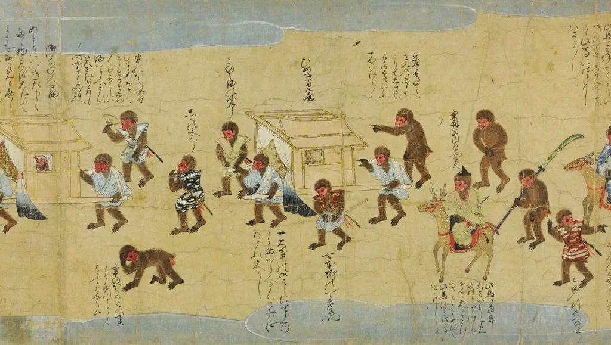
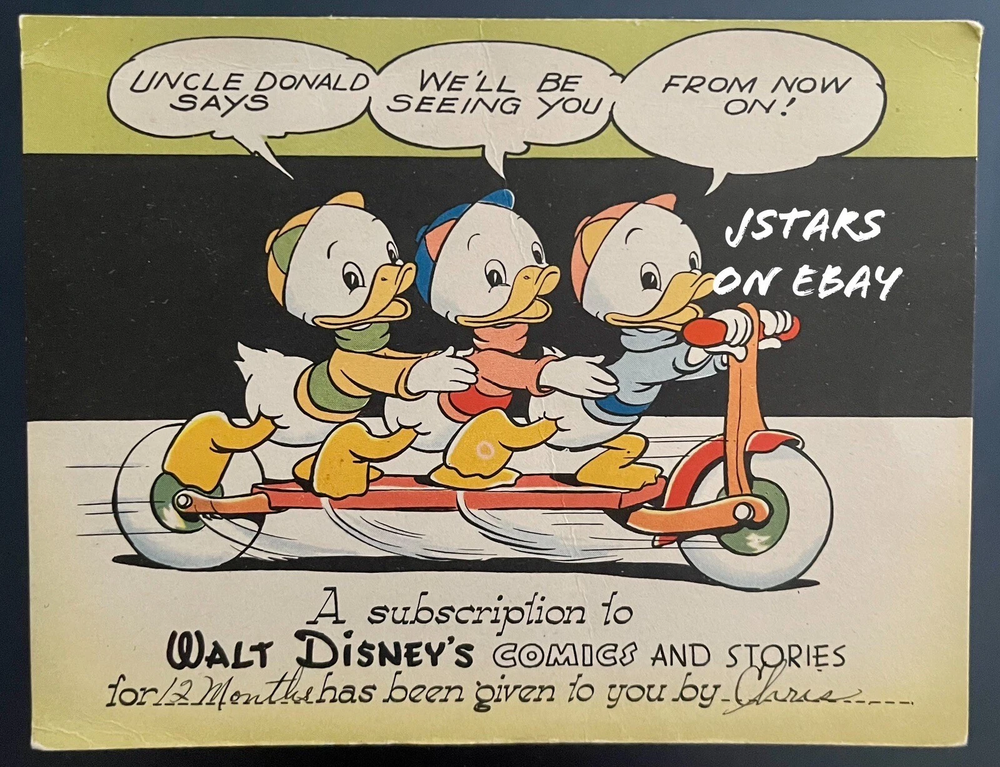

# Japanese Animation

Japan has a rich history of high quality animation, but before there was _anime_, there was (and still is)…

## Manga

In japan, a long tradition of, often comical, illustration and visual storytelling going back to at least the 12th century CE to the _Scrolls of Frolicking Animals_ known as [_Choju jinbutsu giga_](https://kyoto-kosanji.jp/en/treasure/06/)

The _Tale of the Monkeys_ ([_Saru no sōshi_](https://artsandculture.google.com/asset/saru-no-s%C5%8Dshi-illustrated-tale-of-monkeys-a-handscroll-painting/lgF-P5Pd6ys1lA?hl=en)) from the late 1500s (above) has some of the same feel

> The word 'manga' (漫画) has been used to describe various styles over the last two centuries. Artist Katsushika Hokusai (1760–1849), the designer of the famous print, [The Great Wave](https://www.metmuseum.org/art/collection/search/39799), has become closely associated with it because he chose 'manga' for the title of a series of picture-books that he published starting in 1814, the [Hokusai manga](https://www.britishmuseum.org/blog/hokusai-father-manga). These books are collections of assorted sketches, not narratives telling a story, so we have to remember that while Hokusai brought the word manga to popular attention, he thought about it differently than we do today.

But it was almost certainly the post-WWII occupation of Japan by American soldiers that gelled manga into the form in which we consume it today

These mena nd women were, many of them, avid readers of comic books and the comics of the era have been described as a "[Golden Age](https://sites.udel.edu/anomalousbooks/golden-age-comic-books/)" of the medium, featuring stories about names we recognize to this day:

> Superman, Batman and Robin, Wonder Woman, Plastic Man, Green Lantern and the Flash

Besides super heroes other kinds of stories were also told in comics form:

Stories of youths like Archie Andrews, of cowboys and soldiers as well as Sci-Fi, Horror and "Funny Animal" tales were popular widely read

Disney got in on the act and produced stories like those of Donald Duck and his nephews: Huey, Dewey, and Louie

The blend of influences native to Japan and those from America [gave rise to the commercial product we commonly call "manga"](https://www.youtube.com/watch?v=8aHL_k1nvzI) today with titles like _Astro Boy_ (or _Mighty Atom_ or _Tetsuwan Atomu_)

Which is a good place to start talking about…

## Anime

### [Astro Boy](https://tezukaosamu.net/en/anime/30.html)

////TODO

<!--https://www.youtube.com/watch?v=PCFZZy9-j-8-->

